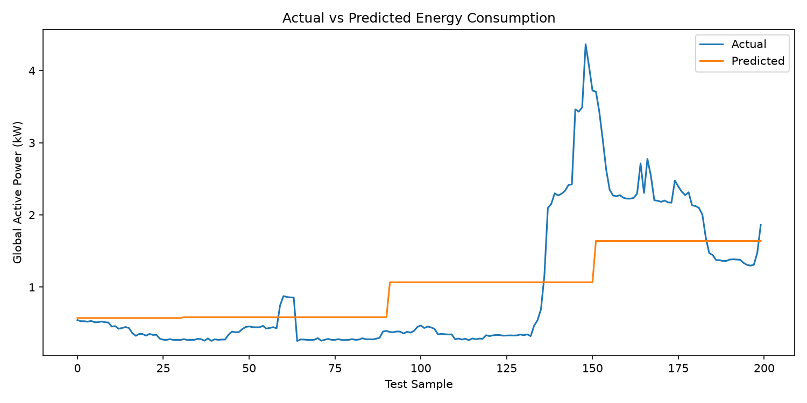
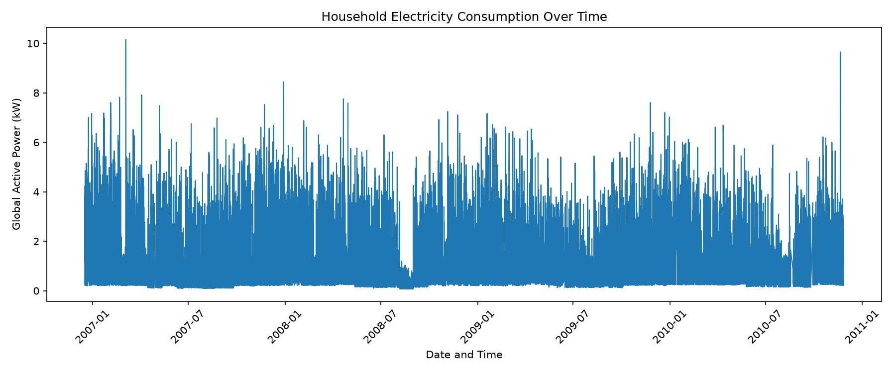

# ⚡ AI Energy Consumption Forecasting System

A machine learning application that forecasts household electricity consumption and visualizes historical energy usage through an interactive Streamlit dashboard.

## 🚀 Live Demo

**[Launch the AI Energy Forecasting App](https://ai-energy-consumption-forecasting-q3uaa9j8hqcnygzujpsqq5.streamlit.app/)**

## ✨ Features

- 🔮 Predict household electricity consumption for a selected date and hour.
- 📊 Visualize historical electricity consumption trends.
- 📈 Display historical dataset records in an interactive dashboard.
- 🤖 Integrate a trained machine learning model.
- 🌐 Deploy the application using Streamlit Community Cloud.

## 🛠️ Technologies Used

- **Python** — core programming language
- **Pandas** — data processing
- **Scikit-learn** — machine learning
- **Joblib** — model loading
- **Streamlit** — interactive web dashboard
- **Git and GitHub** — version control and project hosting

## 📂 Project Structure

```text
AI-Energy-Forecasting/
├── data/
├── docs/
├── models/
├── outputs/
├── src/
├── app.py
├── main.py
├── requirements.txt
└── README.md
```

## ⚙️ Run Locally

1. Clone the repository:

   ```bash
   git clone https://github.com/megha-cse/AI-Energy-Consumption-Forecasting.git
   ```

2. Open the project folder:

   ```bash
   cd AI-Energy-Consumption-Forecasting
   ```

3. Install the dependencies:

   ```bash
   pip install -r requirements.txt
   ```

4. Ensure the required dataset is available in the `data/` folder and the trained model is available in `models/`.

5. Start the dashboard:

   ```bash
   python -m streamlit run app.py
   ```

## 📊 Dataset

This project uses household electricity consumption data. The original dataset is not included in the repository because of its large file size. Place the required dataset at:

`data/household_power_consumption.txt`

## 🎯 Learning Outcomes

- Data preprocessing and handling
- Machine learning model integration
- Interactive dashboard development
- Project version control with GitHub
- Application deployment with Streamlit

## 👩‍💻 Author

**Megha**  
Computer Science Engineering Student

---

⭐ If you find this project interesting, feel free to explore the repository and try the live demo!
## 📸 Project Visualizations

### Actual vs Predicted Energy Consumption


### Historical Energy Consumption

